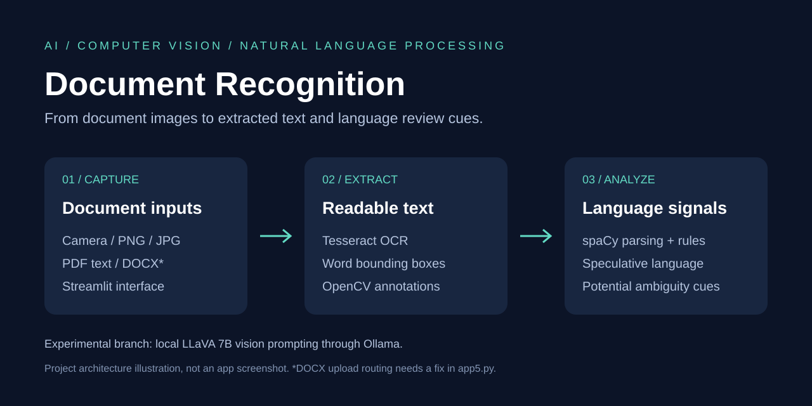

# AI Document Recognition

### Document OCR, text extraction, and NLP review with Python



**AI-Document-Recognition** is an educational computer vision and natural language processing project. It combines a Streamlit interface, Tesseract OCR, OpenCV image annotations, and spaCy language analysis to turn document images into readable text and surface potential language issues. A separate experiment uses a local LLaVA vision model through Ollama.

The **AI** prefix reflects the combination of OCR, pretrained NLP, and a vision-language model experiment. The repository does not train a custom image classifier or deep learning model. The graphic above is an architecture illustration, not a captured application screen.

## Features

- Capture an image using a browser camera (`app.py`).
- Upload PNG, JPG, or JPEG document images (`app2.py` through `app5.py`).
- Extract image text with Tesseract using page segmentation mode 6.
- Obtain OCR word boxes with confidence greater than 60 and draw image overlays.
- Analyze extracted English text with spaCy and simple rules.
- Extract embedded PDF text and provide a DOCX paragraph extraction function (`app5.py`).
- Display extracted text, analysis JSON, and, in later variants, category counters.
- Experiment with image understanding and ambiguity analysis using `llava:7b` (`main.py`).

## Repository guide

| File | Purpose |
| --- | --- |
| `app.py` | Camera capture, OCR, language analysis, and green OCR boxes |
| `app2.py` | Image upload alternative to camera capture |
| `app3.py` | Adds category assignment and colored annotation logic |
| `app4.py` | Adds category counters to the annotated image flow |
| `app5.py` | Extends uploads to PDF and DOCX, with the limitations below |
| `main.py` | Standalone Ollama/LLaVA image prompt experiment |
| `requirements.txt` | Direct Python dependencies, including optional experiment dependencies |
| `docs/project-overview.svg` | Repository project illustration |

The app files are successive standalone prototypes. Launch one at a time; `main.py` is not the Streamlit entry point.

## How it works

1. Streamlit receives a camera image or uploaded file and writes it into the working directory.
2. Image inputs pass through OpenCV and Tesseract. PDF inputs use PyMuPDF embedded text extraction; the DOCX helper uses python-docx paragraphs.
3. spaCy's `en_core_web_sm` pipeline supplies sentence boundaries, dependency labels, and named entity information.
4. Rules collect review cues and Streamlit displays the results. Image variants also draw OCR rectangles.

| Analysis key | Rule implemented in the source |
| --- | --- |
| `long_sentences` | Sentences containing more than 100 spaCy tokens |
| `speculative_modals` | Matches `may`, `might`, `could`, `perhaps`, or `possibly` |
| `coordination_ambiguity` | Tokens with dependency label `conj` |
| `referent_ambiguity` | Tokens labeled `nsubj` or `dobj` with no named entity type |

These rules produce review candidates. A conjunction or non-entity subject/object does not establish that text is ambiguous.

## Setup

Use a fresh Python environment. A modern Python version supported by the dependencies is required; Python 3.11 is a reasonable starting point, but this repository does not yet provide a tested compatibility matrix or dependency lockfile. The original local environment used Python 3.9.

```powershell
git clone https://github.com/vams2krish/AI-Document-Recognition.git
cd AI-Document-Recognition
py -3.11 -m venv .venv
.\.venv\Scripts\Activate.ps1
python -m pip install --upgrade pip
python -m pip install -r requirements.txt
python -m spacy download en_core_web_sm
```

### Install Tesseract separately

`pytesseract` is a Python wrapper; the Tesseract executable and English language data must also be installed. Every Streamlit variant currently sets this Windows path:

```python
pytesseract.pytesseract.tesseract_cmd = r'C:\Program Files\Tesseract-OCR\tesseract.exe'
```

Install Tesseract at that location or edit the assignment in the app you run. On other operating systems, install the native Tesseract package and update or remove that assignment so pytesseract can use the executable on `PATH`.

Verify installation:

```powershell
& 'C:\Program Files\Tesseract-OCR\tesseract.exe' --version
python -m spacy validate
```

## Run the application

For document images:

```powershell
python -m streamlit run app4.py
```

Open the local address printed by Streamlit, upload a clear document image, and inspect the extracted text, JSON analysis, counters, and annotation preview.

Other entry points:

```powershell
python -m streamlit run app.py     # Browser camera; grant camera access
python -m streamlit run app2.py    # Basic image upload
python -m streamlit run app3.py    # Annotated image upload
python -m streamlit run app5.py    # Image and PDF prototype; see DOCX limitation
```

Use a well-lit, upright image of printed English text for an initial trial. There is no bundled evaluation dataset or measured accuracy score.

### Optional LLaVA experiment

Install and start Ollama separately, then download the model:

```powershell
ollama pull llava:7b
```

Place your own image at `document.png` in the repository root, then run:

```powershell
python main.py
```

The script asks the model to extract text and identify coordination ambiguity, then prints the response. Model weights are downloaded separately and require sufficient local memory and disk space. This experiment is independent of the Streamlit OCR pipeline. No hosted API key is required by these scripts.

## Current limitations

- **DOCX upload dispatch:** `app5.py` derives file type by splitting the MIME type. Standard DOCX MIME values do not yield `docx`, so the DOCX extraction helper exists but normal DOCX uploads may be rejected until dispatch is corrected.
- **Scanned PDFs:** PDF extraction reads embedded text; it does not rasterize scanned pages and run OCR on them. DOCX extraction reads paragraphs, not a complete layout or table reconstruction.
- **Annotation mapping:** `app3.py` and `app4.py` compare OCR words with NLP output strings, including full sentences, which can miss matches. `app5.py` does not assign category types before highlighting, so its boxes use the default color.
- **Color labels:** the speculative color tuple is described as yellow in comments but appears cyan in OpenCV's BGR color order.
- **Counters:** counts divided by detected OCR boxes mix sentence/token units and can overlap. They are prototype diagnostics, not calibrated quality scores or accuracy percentages.
- **OCR confidence parsing:** `int(data['conf'][i])` may fail with decimal confidence strings from some Tesseract versions. If highlighting fails for this reason, use float parsing and handle invalid values.
- **Image handling:** early variants write Pillow RGB arrays through OpenCV without RGB-to-BGR conversion, which can swap display colors. There is no dedicated deskewing or denoising pipeline.
- **Local files:** fixed output filenames can overwrite earlier uploads and collide across sessions. Uploaded documents remain on disk. Use sample documents in a local environment and remove generated files when finished.
- **Validation:** publication checks cover Python syntax and repository contents. End-to-end OCR, model inference, and package installation have not been verified for this release.

## Troubleshooting

| Symptom | Check |
| --- | --- |
| Tesseract executable not found | Install the native executable and correct the configured path |
| spaCy cannot load `en_core_web_sm` | Run `python -m spacy download en_core_web_sm` in the active environment |
| `No module named fitz` | Install `PyMuPDF`, which supplies the `fitz` import |
| PDF produces no text | Check whether it is a scanned image-only PDF |
| DOCX reports unsupported type | Correct the MIME dispatch in `app5.py` as described above |
| Ollama connection/model error | Start Ollama, pull `llava:7b`, and confirm `document.png` exists |
| No or incorrect highlights | Check OCR confidence parsing and the annotation mapping limitations |

## Possible next steps

Unify the prototypes, make the Tesseract path configurable, fix MIME dispatch and OCR confidence parsing, align text spans with OCR coordinates, use per-session temporary files, add scanned-PDF OCR, and evaluate against labeled sample documents before reporting performance.

## License

No project license has been selected. Dependency and model licenses apply separately; review them for your intended use.
